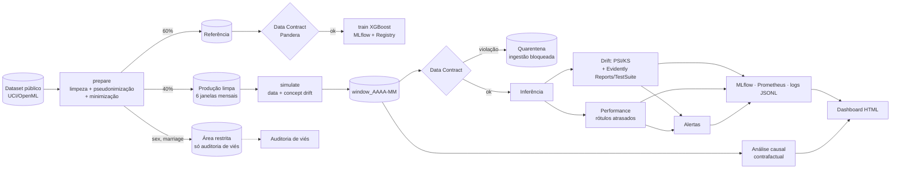
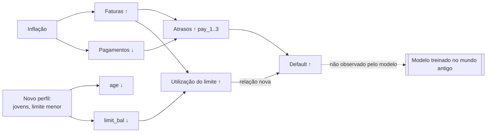

# Credit Scoring em Produção — Observabilidade, Drift, Data Contracts e Governança

**Tech Challenge — Fase 4 (MLET / PósTech)**
Tema: Observabilidade Contínua, Detecção de Drift, Qualidade de Dados e Governança em Produção.

> 🎥 **Vídeo STAR (≤ 5 min):** `<COLE AQUI O LINK DO VÍDEO>`
> 📊 **Dashboard:** [`reports/monitoring_dashboard.html`](reports/monitoring_dashboard.html) · **Análise causal:** [`reports/causal_analysis.md`](reports/causal_analysis.md)

---

## Sumário

1. [Contexto e problema](#1-contexto-e-problema)
2. [Arquitetura](#2-arquitetura)
3. [Sequência de execução / deploy](#3-sequência-de-execução--deploy)
4. [Etapa 1 — Validação de Dados e Contratos](#4-etapa-1--validação-de-dados-e-contratos-pandera)
5. [Etapa 2 — Simulação e Detecção de Drift](#5-etapa-2--simulação-e-detecção-de-drift-evidently-ai)
6. [Etapa 3 — Observabilidade de Pipelines e Modelos](#6-etapa-3--observabilidade-de-pipelines-e-modelos)
7. [Etapa 4 — Governança, LGPD e Causalidade](#7-etapa-4--governança-lgpd-e-causalidade)
8. [Resultados e lições aprendidas](#8-resultados-e-lições-aprendidas)
9. [Estrutura do repositório e convenção de commits](#9-estrutura-do-repositório-e-convenção-de-commits)

---

## 1. Contexto e problema

Uma fintech tem um modelo de *Credit Scoring* em produção. Com inflação e novos perfis de clientes, a
diretoria suspeita de **degradação silenciosa**: o modelo continua respondendo (nenhum erro 500, nenhuma
exceção), mas as decisões ficam piores. Este projeto constrói a **camada de sustentação e confiabilidade**:

| Pergunta de negócio | Mecanismo implementado |
|---|---|
| Dados ruins podem entrar no modelo? | **Data Contract (Pandera)** com 11 regras rígidas, quarentena e bloqueio da ingestão |
| O perfil dos clientes mudou? | **Data drift**: PSI + Kolmogorov-Smirnov (próprios) + **Evidently AI** (HTML) |
| O modelo ainda acerta? | **Concept drift**: AUC/KS/recall por janela com rótulos atrasados + target drift |
| O pipeline está saudável? | Logs JSON centralizados, **MLflow** (tracking + registry), métricas **Prometheus**, dashboard HTML |
| Por que degradou? | **Análise causal contrafactual** (intervenção em cada mecanismo de drift) |
| Estamos em conformidade? | Plano **LGPD**: pseudonimização, minimização, base legal, retenção, art. 20, auditoria de viés |

**Dataset:** [Default of Credit Card Clients](https://archive.ics.uci.edu/dataset/350) (UCI / OpenML id 42477) —
30.000 clientes, classificação binária de inadimplência (22,1% de default). Atende ao requisito de ≥ 5.000 amostras.
É baixado automaticamente pelo pipeline (nenhum dado é versionado no Git).

---

## 2. Arquitetura



| Componente | Biblioteca | Arquivo |
|---|---|---|
| Modelo baseline | **XGBoost** + scikit-learn | [`src/credit_risk/train.py`](src/credit_risk/train.py) |
| Data Contract | **Pandera** 0.20 | [`src/credit_risk/contracts.py`](src/credit_risk/contracts.py) |
| Simulação de drift | NumPy/pandas | [`src/credit_risk/drift_simulation.py`](src/credit_risk/drift_simulation.py) |
| Detecção de drift | **Evidently AI** 0.4 + SciPy (PSI/KS) | [`src/credit_risk/drift_detection.py`](src/credit_risk/drift_detection.py) |
| Monitoramento / alertas | **MLflow**, **prometheus-client** | [`src/credit_risk/monitoring.py`](src/credit_risk/monitoring.py) |
| Logs centralizados | JSON Lines | [`src/credit_risk/logging_utils.py`](src/credit_risk/logging_utils.py) |
| Análise causal | intervenções contrafactuais | [`src/credit_risk/causal_analysis.py`](src/credit_risk/causal_analysis.py) |
| Dashboard | Plotly | [`src/credit_risk/dashboard.py`](src/credit_risk/dashboard.py) |
| Orquestração | CLI `credit-risk` | [`src/credit_risk/cli.py`](src/credit_risk/cli.py) |

---

## 3. Sequência de execução / deploy

A ordem é obrigatória: cada passo consome o artefato do anterior e **nenhum dado chega ao modelo sem passar pelo contrato**.

| # | Comando | O que faz | Artefato gerado |
|---|---|---|---|
| 0 | `pip install -r requirements.txt && pip install -e .` | ambiente (Python 3.11) | `.venv` |
| 1 | `credit-risk prepare` | baixa, limpa, pseudonimiza, segrega PII, separa Referência × Produção | `data/reference`, `data/production/clean_*`, `data/restricted` |
| 2 | `credit-risk train` | valida a Referência no contrato → treina XGBoost → registra no MLflow | `models/`, `mlflow.db`, model registry v1 |
| 3 | `credit-risk validate` | força um lote corrompido e mostra o contrato **bloqueando** | `data/quarantine/*` |
| 4 | `credit-risk simulate` | cria 6 meses de produção com drift progressivo | `data/production/window_*.parquet` |
| 5 | `credit-risk monitor --window all --reset` | contrato → inferência → drift → performance → alertas (por mês) | `reports/drift/*`, `reports/alerts.jsonl`, MLflow runs |
| 6 | `credit-risk causal` | intervenções contrafactuais na janela mais degradada | `reports/causal_analysis.{md,json}` |
| 7 | `credit-risk dashboard` | consolida tudo em um painel | `reports/monitoring_dashboard.html` |
| — | `credit-risk run-all` | 1 → 7 de uma vez (≈ 6 min) | tudo acima |

```bash
python -m venv .venv && .venv/Scripts/activate      # Linux/Mac: source .venv/bin/activate
pip install -r requirements.txt && pip install -e .
credit-risk run-all
mlflow ui --backend-store-uri sqlite:///mlflow.db    # http://localhost:5000
```

### Intervalo de execução (agendamento)

O monitoramento foi desenhado para rodar **agendado, uma janela por execução** — reproduzindo a passagem do tempo:
`credit-risk monitor --window next --dashboard` processa o próximo mês ainda não monitorado (estado em
`data/monitoring_state.json`) e atualiza o painel.

| Ambiente | Agendador | Intervalo | Arquivo |
|---|---|---|---|
| Local (Windows) | Task Scheduler | a cada 10 min na demo (1 execução = 1 mês simulado) | [`scripts/schedule_monitoring.ps1`](scripts/schedule_monitoring.ps1) |
| CI/CD | GitHub Actions `schedule` | mensal (`0 9 1 * *`) + manual | [`.github/workflows/scheduled-monitoring.yml`](.github/workflows/scheduled-monitoring.yml) |
| Produção (sugestão) | Airflow/cron | mensal para drift de features; trimestral para performance (rótulo de default chega com ~90 dias) | — |

```powershell
./scripts/schedule_monitoring.ps1 -IntervalMinutes 10   # registra a tarefa
credit-risk monitor --reset --window next               # (opcional) recomeça do 1º mês
./scripts/schedule_monitoring.ps1 -Unregister           # remove a tarefa
```

### Deploy em containers

```bash
docker compose up --build
```
Ordem garantida por `depends_on: service_completed_successfully`: **pipeline** (batch) → **mlflow** (UI em `:5000`)
e **dashboard** (relatórios em `:8080`). CI ([`ci.yml`](.github/workflows/ci.yml)): testes unitários → *smoke* do
pipeline completo → upload dos relatórios como artefato.

---

## 4. Etapa 1 — Validação de Dados e Contratos (Pandera)

**Foco: garantir que lixo não entre no modelo.**

### 4.1 Modelo baseline

XGBoost (400 árvores máx., profundidade 4, *early stopping* na validação). O limiar de decisão (0,26) é escolhido
maximizando F1 na **validação** — nunca no holdout. Atributos sensíveis (`sex`, `marriage`) **não** são features.

| Métrica (holdout de referência, n = 3.596) | Valor |
|---|---|
| AUC | **0,766** |
| Gini | 0,533 |
| KS (separação bons × maus) | 0,417 |
| Precision / Recall / F1 | 0,506 / 0,573 / 0,537 |
| Taxa de aprovação | 74,9% |

### 4.2 Contrato de dados — `credit_scoring_contract_v1.0.0`

Aplicado em **todo** lote (referência no treino e cada janela de produção), com `lazy=True` (coleta todas as
violações de uma vez) e `strict=True`.

| # | Regra | Coluna(s) | Motivação |
|---|---|---|---|
| R1 | não nulo, único, hash de 20 hex | `customer_id` | sem duplicidade de cliente; garante pseudonimização |
| R2 | não nulo, 1.000 ≤ x ≤ 2.000.000 | `limit_bal` (proxy de renda) | renda/limite nulo ou absurdo |
| R3 | 18 ≤ idade ≤ 100 | `age` | maioridade civil para contratar crédito |
| R4 | domínio {1,2,3,4} | `education` | código fora do dicionário |
| R5 | −2 ≤ x ≤ 8 | `pay_1..pay_6` | status de pagamento documentado |
| R6 | −1M ≤ x ≤ 5M | `bill_amt_*` | valores de fatura plausíveis |
| R7 | 0 ≤ x ≤ 5M | `pay_amt_*` | pagamento nunca negativo |
| R8 | {0,1}, opcional | `default` | rótulo binário (chega com atraso) |
| R9 | sem linhas duplicadas | lote | reprocessamento/duplicação de carga |
| R10 | lote não vazio | lote | falha silenciosa de extração |
| R11 | `strict=True` | schema | **coluna não prevista é rejeitada** (ex.: `cpf`) → barreira contra vazamento de PII |

### 4.3 Demonstração: lote corrompido bloqueado

`credit-risk validate` injeta erros em 300 linhas reais e tenta ingeri-las:

```
[BLOQUEADO] Lote 'demo_corrupted_batch' bloqueado: 156 violação(ões) do contrato v1.0.0
```

| Coluna | Regra violada | Linhas |
|---|---|---|
| `<lote>` | linhas duplicadas | 5 |
| `age` | ≥ 18 / ≤ 100 | 5 / 2 |
| `cpf` | `column_in_schema` (PII não autorizada) | 1 |
| `customer_id` | unicidade | 10 |
| `education` | domínio | 4 |
| `limit_bal` | não nulo / faixa | 7 / 3 |
| `pay_amt_1` | ≥ 0 | 4 |

O lote vai para `data/quarantine/` (lote original + violações + resumo JSON), o evento `ingestion_blocked` é
logado e a inferência **não acontece**. Testes: [`tests/test_contracts.py`](tests/test_contracts.py) cobre cada regra isoladamente.

---

## 5. Etapa 2 — Simulação e Detecção de Drift (Evidently AI)

**Foco: diagnosticar a degradação ao longo do tempo.**

### 5.1 Separação Referência × Produção

| Dataset | Linhas | Uso |
|---|---|---|
| Referência | 17.979 (60%) | treino (80%) e holdout (20%); base de comparação do drift |
| Produção | 11.986 (40%) | 6 janelas mensais (jan–jun/2026, ~2.000 linhas cada), onde o drift é injetado |

### 5.2 Cenário simulado (intensidade cresce de 0 em jan até 1 em jun)

| Mecanismo | Alteração | Tipo |
|---|---|---|
| `inflation_bills` | faturas `bill_amt_*` +45% | Data drift (P(X)) |
| `new_young_low_limit` | até 50% de clientes novos: 18–28 anos, limite 30–70% menor | Data drift |
| `lower_payments` | pagamentos `pay_amt_*` −40% | Data drift |
| `payment_delays` | +1 mês de atraso em `pay_1..pay_3` (prob. até 40%) | Data drift |
| `concept_default` | utilização > 60% passa a gerar default (até 35% dos bons pagadores) | **Concept drift (P(y\|X))** |

Janeiro é o **controle** (sem drift). Os dados com drift **continuam passando no contrato**: drift é dado *válido
porém diferente* — por isso contrato e monitor de drift são camadas complementares.

### 5.3 Testes estatísticos

* **PSI** (métrica primária, 10 bins por quantis da referência): < 0,1 estável · 0,1–0,2 atenção · **> 0,2 drift**.
* **Kolmogorov-Smirnov** (p < 0,05) como confirmação.
* **Evidently AI**: `DataDriftPreset` (KS para numéricas, PSI para categóricas, *dataset drift* se > 30% das
  features), `DataQualityPreset`, `ClassificationPreset` + `TargetDriftPreset` e uma `TestSuite` pass/fail.

### 5.4 Resultado (junho × referência)

| Feature | PSI | KS | Média ref → jun | Status |
|---|---|---|---|---|
| `pay_3` | **3,07** | 0,35 | −0,16 → 0,43 | 🔴 drift |
| `pay_2` | **2,34** | 0,34 | −0,13 → 0,45 | 🔴 drift |
| `age` | **0,60** | 0,34 | 35,4 → 29,9 | 🔴 drift |
| `pay_1` | **0,45** | 0,29 | −0,01 → 0,48 | 🔴 drift |
| `pay_amt_1` | **0,27** | 0,20 | 5,8k → 3,4k | 🔴 drift |
| `limit_bal` | 0,18 | 0,17 | 168k → 127k | 🟡 atenção |
| `bill_amt_1` | 0,06 | 0,11 | 52k → 74k | 🟢 PSI estável / KS detecta |
| `pay_4..6`, `education` | < 0,01 | ≈ 0 | — | 🟢 estável (não foram alterados) |

Evidently: **81% das features com drift → dataset drift = True**; 8 de 8 testes da TestSuite falharam em junho.

**Entregáveis (HTML Evidently):**
[`data_drift_2026-06.html`](reports/drift/data_drift_2026-06.html) ·
[`model_performance_2026-06.html`](reports/drift/model_performance_2026-06.html) ·
[`test_suite_2026-06.html`](reports/drift/test_suite_2026-06.html) ·
controle: [`data_drift_2026-01.html`](reports/drift/data_drift_2026-01.html) · tabelas PSI/KS em `reports/drift/psi_ks_*.csv`.

---

## 6. Etapa 3 — Observabilidade de Pipelines e Modelos

### 6.1 Centralização de logs e métricas

* **Logs estruturados** (`logs/pipeline.jsonl`): todo evento tem `ts`, `run_id` (correlação), `event`, `stage`,
  `status`, `duration_ms` e contexto. Eventos: `stage_started/succeeded/failed`, `ingestion_blocked`,
  `alert_raised`, `window_processed`, `model_trained`. Formato pronto para Loki/Datadog/ELK.
* **MLflow** (`mlflow.db`): run `baseline-training` (parâmetros, métricas, modelo registrado `credit-scoring-xgb` v1)
  + um run `monitor-AAAA-MM` por janela com métricas por *step* (gráfico temporal nativo no MLflow UI) e os HTMLs
  do Evidently como artefatos.
* **Prometheus** (`reports/metrics/credit_risk.prom`, formato textfile do node_exporter): integração opcional com a
  stack da Fase 3.
* **Dashboard** ([`reports/monitoring_dashboard.html`](reports/monitoring_dashboard.html)): KPIs, saúde do pipeline,
  contrato, heatmap de PSI, performance, análise causal, alertas e links para os relatórios.

### 6.2 Métricas de saúde definidas

| Camada | Métrica | Fonte | Alerta |
|---|---|---|---|
| Pipeline | status por tarefa (ingest, contrato, inferência, drift, performance) | logs / `pipeline_success` | qualquer `stage_failed` |
| Pipeline | latência por tarefa e total (ms) | `duration_ms`, `latency_*_ms` | > 2× mediana histórica |
| Pipeline | volume processado / rejeitado | `rows_in`, `rows_rejected` | `rows_rejected > 0` |
| Infra | latência de inferência por 1k linhas | `latency_ms_per_1k` (~1,5 ms) | > 2× baseline |
| Dados | lotes bloqueados pelo contrato | `ingestion_blocked` | ≥ 1 |
| Drift | PSI por feature | `psi_*` | > 0,2 (warning) |
| Drift | fração de features com drift (Evidently) | `share_drifted_evidently` | > 30% (critical) |
| Modelo | AUC, KS, recall, taxa de aprovação | `perf_*` | queda de AUC > 0,05 (critical) |
| Modelo | taxa de default observada | `perf_observed_default_rate` | Δ > 5 p.p. (critical) |
| Operação | nº de alertas e testes falhos | `n_alerts`, `tests_failed` | — |

### 6.3 Evolução observada

| Janela | AUC | KS | Aprovação | Default real | Default previsto | Drift (Evidently) | Features PSI>0,2 | Alertas |
|---|---|---|---|---|---|---|---|---|
| 2026-01 (controle) | 0,775 | 0,41 | 75,5% | 22,1% | 24,5% | 10% | 0 | 0 |
| 2026-02 | 0,766 | 0,41 | 72,0% | 24,1% | 28,0% | 48% | 2 | 3 |
| 2026-03 | 0,733 | 0,38 | 67,8% | 25,2% | 32,2% | 76% | 2 | 3 |
| 2026-04 | 0,701 | 0,29 | 65,9% | 30,1% | 34,1% | 76% | 3 | 6 |
| 2026-05 | 0,704 | 0,29 | 60,3% | 31,4% | 39,7% | 81% | 4 | 7 |
| 2026-06 | 0,707 | 0,29 | 55,5% | 35,4% | 44,5% | 81% | 5 | 8 |

Total: **27 alertas** (`reports/alerts.jsonl`), todos registrados em log, MLflow e no dashboard.

---

## 7. Etapa 4 — Governança, LGPD e Causalidade

### 7.1 Inventário de dados pessoais (PII) e tratamento

| Dado | Classificação LGPD | Tratamento no projeto |
|---|---|---|
| Identificador do cliente (CPF em produção) | dado pessoal direto | **pseudonimizado** na ingestão com HMAC-SHA256 + chave secreta fora do código (`PSEUDONYMIZATION_KEY`, em cofre) — art. 13 §4 |
| `sex`, `marriage` | dado pessoal; risco discriminatório | **excluídos das features** (minimização, art. 6º III) e segregados em `data/restricted/`, usados **só** para auditoria de viés |
| `age` | dado pessoal | usado (relevante ao risco e à maioridade); monitorado na auditoria de viés por faixa |
| `limit_bal`, `bill_amt`, `pay_amt`, `pay_*` | dados financeiros | necessários à finalidade (análise de crédito) |
| Dados sensíveis do art. 5º II (origem racial, saúde, religião, biometria…) | sensível | **não coletados** |
| Logs e métricas | — | **sem PII**: só agregados, contagens e IDs de execução |

Controles técnicos (*Privacy by Design / by Default*): contrato `strict=True` rejeita colunas não previstas (ex.: `cpf`
vazando num lote); `data/` no `.gitignore` (nenhum dado de cliente versionado); container roda com usuário não-root;
segredos via variável de ambiente/GitHub Secrets.

### 7.2 Base legal da decisão de crédito

| Tratamento | Base legal (Lei 13.709/2018) |
|---|---|
| Análise de risco e concessão de crédito | **art. 7º, X — proteção do crédito** (inclui consulta a birôs e Cadastro Positivo, Lei 12.414/2011) |
| Execução do contrato de crédito | art. 7º, V — execução de contrato ou procedimentos preliminares a pedido do titular |
| Guarda para fiscalização (BACEN, COAF) | art. 7º, II — cumprimento de obrigação legal/regulatória |
| Monitoramento de drift e auditoria de viés | art. 7º, IX — legítimo interesse, com LIA documentado e dados pseudonimizados |

**Decisão automatizada (art. 20):** o titular pode solicitar **revisão** da decisão tomada só com base no modelo.
Garantimos: (i) explicação dos principais fatores (importância das features registrada em `models/model_metadata.json`;
explicações locais via SHAP como evolução), (ii) fila de revisão humana para negativas, (iii) registro do
`model_version` + `run_id` de cada decisão para rastreabilidade.

### 7.3 Plano de retenção

| Artefato | Prazo | Fundamento | Descarte |
|---|---|---|---|
| Dados cadastrais e de operação de crédito | duração do contrato + **5 anos** | CDC art. 43 §1º; Lei 9.613/98 art. 10 (PLD) | anonimização ou exclusão |
| Histórico de adimplemento (Cadastro Positivo) | até **15 anos** | Lei 12.414/2011 art. 14 | exclusão |
| Dataset de treino (pseudonimizado) | enquanto o modelo estiver em produção + 5 anos | auditoria/reprodutibilidade do modelo | exclusão + rotação da chave HMAC |
| Janelas de monitoramento | **13 meses** rolantes | comparar sazonalidade anual | exclusão automática |
| Lotes em quarentena | **30 dias** | só para diagnóstico | exclusão automática |
| Logs operacionais (sem PII) | 1 ano quente / 5 anos frio | trilha de auditoria | expurgo |
| Registro de decisões (score, versão, motivo) | 5 anos | art. 20 e fiscalização | anonimização |

Direitos do titular (art. 18): acesso, correção, anonimização, portabilidade e eliminação atendidos pelo
encarregado (DPO); como o ID é pseudonimizado, a re-identificação só é possível pela área autorizada com a chave.
Recomenda-se manter um **RIPD** (Relatório de Impacto, art. 38) para o modelo.

### 7.4 Mitigação de vieses

Auditoria no holdout com os atributos segregados (nunca usados como feature) — *disparate impact ratio*
(razão entre a menor e a maior taxa de aprovação; regra dos 4/5 ≥ 0,8):

| Grupo | Taxas de aprovação | DIR | Situação |
|---|---|---|---|
| Sexo | masc. 71,3% · fem. 77,2% | 0,92 | ✅ |
| Estado civil | casado 73,4% · solteiro 76,3% · outros 70,5% | 0,92 | ✅ |
| Faixa etária | 18–25: 69,3% · 26–35: 77,5% · 36–50: 76,5% · 51+: 63,2% | **0,82** | ⚠️ limítrofe |

Ações: (1) faixa etária no limite → monitorar DIR a cada retreino e bloquear promoção do modelo se < 0,8;
(2) o drift simulado traz **mais jovens com limite menor** — tende a piorar a aprovação dessa faixa, então o DIR
deve entrar no painel de produção; (3) sexo e estado civil fora do modelo (*fairness through unawareness*) e
checagem de proxies; (4) revisão humana obrigatória para negativas em faixas com DIR < 0,85.

### 7.5 Análise causal da degradação

Hipótese causal (DAG) do cenário macroeconômico:



Como controlamos o processo gerador, aplicamos **intervenções** `do(mecanismo = desligado)` mantendo os mesmos
clientes e sorteios, e medimos o modelo em cada mundo contrafactual (junho, intensidade máxima):

| Cenário | AUC | Default real | Default previsto | PSI do score |
|---|---|---|---|---|
| sem drift (controle) | 0,787 | 22,5% | 25,1% | 0,01 |
| **observado (todos os mecanismos)** | **0,707** | 35,4% | 44,5% | 0,70 |
| apenas covariate shift (P(X)) | 0,771 | 22,5% | 44,5% | 0,70 |
| apenas concept drift (P(y\|X)) | 0,719 | 32,0% | 25,1% | 0,01 |

| Mecanismo | AUC recuperada se removido | Efeito principal |
|---|---|---|
| `concept_default` | **+0,065** | causa raiz da perda de discriminação (AUC) |
| `payment_delays` | +0,014 | maior causa do aumento de reprovações (+9,7 p.p. de default previsto) |
| `new_young_low_limit` | +0,007 | drift de `age`/`limit_bal` |
| `inflation_bills`, `lower_payments` | ≈ 0 | drift de magnitude, pouco efeito no ranking |

**Conclusões causais**

1. **O covariate shift muda *quanto* o modelo aprova** (aprovação cai de 75% → 56%), mas quase não muda a
   capacidade de ordenar risco (AUC 0,787 → 0,771).
2. **O concept drift é a causa raiz da degradação** (≈ 80% da queda de AUC) e é **invisível ao monitor de
   features**: no cenário "apenas concept drift" o PSI do score é 0,01. Só o monitoramento com rótulos
   (performance + target drift) o detecta.
3. **Prescrição:** (a) retreinar com dados recentes rotulados incluindo a utilização do limite como feature
   explícita; (b) recalibrar o limiar para a nova taxa de default; (c) manter monitoramento de rótulos
   (mesmo atrasados) — monitorar só P(X) daria falsa sensação de segurança.

Detalhes completos: [`reports/causal_analysis.md`](reports/causal_analysis.md).

---

## 8. Resultados e lições aprendidas

* ✅ **Contrato bloqueou 100% do lote corrompido** (156 violações em 9 regras), inclusive a coluna `cpf` não autorizada.
* ✅ **Drift detectado já no 2º mês** (PSI de `pay_2`/`pay_3`); dataset drift a partir de março.
* ✅ **Degradação quantificada:** AUC 0,775 → 0,707, KS 0,41 → 0,29, aprovação 75% → 56%; 27 alertas automáticos.
* ✅ **Causa raiz identificada** por contrafactuais: concept drift (utilização × default).

**Lições**
1. *Contrato ≠ drift*: dados de junho são todos válidos e mesmo assim o modelo piorou. Precisamos das duas camadas.
2. *KS é sensível demais com n grande*: no mês de controle o KS sinalizou 2 features (falso positivo); o PSI não.
   Por isso PSI é a métrica primária e KS a confirmação.
3. *PSI não vê tudo*: faturas +45% deram PSI ≈ 0,06 (distribuição de cauda longa), mas KS detectou. Usar mais de um teste.
4. *Drift de features não prova degradação* e *degradação pode ocorrer sem drift de features* (concept drift) —
   rótulos atrasados precisam ser monitorados.
5. *Observabilidade é produto*: logs estruturados + run_id + MLflow tornam cada alerta rastreável até o lote e a versão do modelo.

---

## 9. Estrutura do repositório e convenção de commits

```
├── src/credit_risk/          # pacote do pipeline (CLI: credit-risk)
├── tests/                    # testes de contrato e de drift (pytest)
├── scripts/                  # run_pipeline.ps1, schedule_monitoring.ps1
├── reports/                  # dashboard, relatórios Evidently, alertas, análise causal, métricas Prometheus
├── logs/pipeline.jsonl       # logs centralizados (amostra de execução)
├── models/model_metadata.json# métricas, limiar, fairness, importância (binário fica no MLflow)
├── docs/roteiro_video_star.md# roteiro do vídeo
├── .github/workflows/        # CI + monitoramento agendado
├── Dockerfile, docker-compose.yml
└── requirements.txt, pyproject.toml
```

Commits seguem **Conventional Commits** (`feat`, `fix`, `test`, `docs`, `ci`, `chore`, `build`) com escopo por etapa
(`feat(contracts)`, `feat(drift)`, `feat(observability)`, `docs(governance)`), na mesma ordem das etapas do desafio.

```bash
pytest -q        # 14 testes
```
